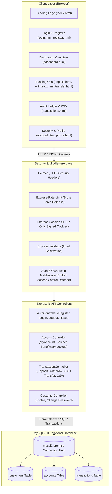
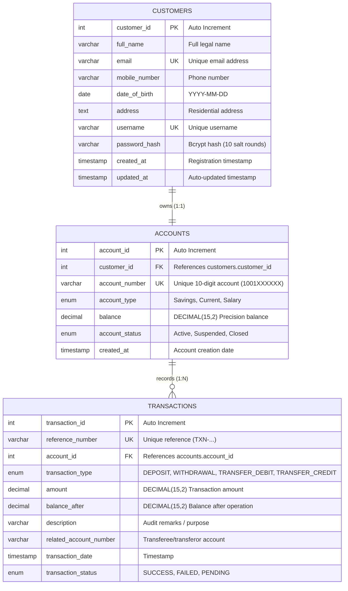

# Banking and Account Management System

A full-stack, secure, production-grade educational **Banking and Account Management System** engineered with clean architecture, ACID-compliant relational data management, salted bcrypt password hashing, and real-time ledger accounting.

Built specifically for college evaluation, project exhibitions, and viva defense with clear separation of concerns and zero unnecessary framework complexity.

---

## Table of Contents

1. [System Architecture Diagram](#system-architecture-diagram)
2. [Database Design & ER Diagram](#database-design--er-diagram)
3. [Technology Stack](#technology-stack)
4. [Project Folder Structure](#project-folder-structure)
5. [Key Features](#key-features)
6. [Pre-Seeded Demo Accounts](#pre-seeded-demo-accounts)
7. [Local Setup & Installation Guide](#local-setup--installation-guide)
8. [REST API Documentation](#rest-api-documentation)
9. [Automated Test Suite & Results](#automated-test-suite--results)
10. [College Project Viva Preparation Guide (16 Questions & Answers)](#college-project-viva-preparation-guide)

---

## System Architecture Diagram



---

## Database Design & ER Diagram

The database is named `banking_management_system`. All monetary balances use `DECIMAL(15, 2)` to eliminate floating-point rounding errors.



---

## Technology Stack

- **Frontend**:
  - HTML5 (Semantic accessible structure)
  - CSS3 (Custom design system with blue, white, and subtle light-grey palette)
  - Vanilla JavaScript ES6+ (Native Fetch API, DOM manipulation, no heavy frontend frameworks)
  - Bootstrap 5 (Responsive grid, offcanvas, modals, and toasts)
  - Bootstrap Icons (Modern banking iconography)

- **Backend**:
  - Node.js (Asynchronous, event-driven JavaScript runtime)
  - Express.js (Fast, unopinionated REST API framework)

- **Database**:
  - MySQL Server 8.0
  - `mysql2/promise` (Connection pool with async/await query execution)

- **Security & Middleware**:
  - `bcrypt` (10 rounds of salted password hashing)
  - `express-session` (Server-side session management with signed `banking.sid` cookie)
  - `express-validator` (Declarative input sanitization and validation)
  - `helmet` (11 HTTP security headers, including CSP and HSTS)
  - `express-rate-limit` (Brute-force protection for authentication endpoints)
  - `dotenv` (Safe environment variable injection)

---

## Project Folder Structure

```
banking-management-system/
│
├── frontend/                     # Client-side presentation layer
│   ├── index.html                # Landing page with hero, features & demo credentials
│   ├── login.html                # Customer login with password toggle & reset modal
│   ├── register.html             # Customer onboarding with automatic account generation
│   ├── dashboard.html            # Main banking portal with metrics & quick actions
│   ├── account.html              # Account details & contact information update
│   ├── deposit.html              # Cash / check deposit simulation
│   ├── withdraw.html             # Cash withdrawal with overdraft defense
│   ├── transfer.html             # Account-to-account transfer with confirmation modal
│   ├── transactions.html         # Filterable audit ledger with CSV statement export
│   ├── profile.html              # Security audit & password change
│   │
│   ├── css/
│   │   └── style.css             # Unified banking design system
│   │
│   └── js/
│       ├── config.js             # Fetch wrapper, toasts, session checks & dynamic navigation
│       ├── auth.js               # Login, registration & password reset
│       ├── dashboard.js          # Live balance cards & recent activity table
│       ├── account.js            # Profile retrieval & contact details updates
│       ├── deposit.js            # Deposit validation & receipt rendering
│       ├── withdraw.js           # Overdraft protection & withdrawal receipts
│       ├── transfer.js           # Beneficiary lookup & ACID transfer execution
│       ├── transactions.js       # Search, filter by type/date, pagination & CSV download
│       └── profile.js            # Password change & active session inspector
│
├── backend/                      # Server-side business logic
│   ├── config/
│   │   └── db.js                 # MySQL2 connection pool with promise support
│   │
│   ├── controllers/
│   │   ├── authController.js     # Register, login, logout, me, demo password reset
│   │   ├── accountController.js  # Account retrieval, balance, beneficiary lookup
│   │   ├── transactionController.js # Deposits, withdrawals, ACID transfers, CSV
│   │   └── customerController.js # Profile updates & bcrypt password change
│   │
│   ├── middleware/
│   │   ├── authMiddleware.js     # Session guard & verified ownership injection
│   │   ├── validation.js         # Express-validator schemas & error formatters
│   │   └── rateLimiter.js        # IP rate limiting for authentication
│   │
│   ├── routes/
│   │   ├── authRoutes.js         # /api/auth routes
│   │   ├── accountRoutes.js      # /api/accounts routes
│   │   ├── transactionRoutes.js  # /api/transactions routes
│   │   └── customerRoutes.js     # /api/customers routes
│   │
│   ├── utils/
│   │   └── helpers.js            # Unique account number & reference generators
│   │
│   ├── app.js                    # Express app configuration & middleware pipeline
│   └── server.js                 # Server bootstrap & connection diagnostic
│
├── database/
│   └── database.sql              # Complete schema, foreign keys, indexes & seed data
│
├── tests/
│   └── test-suite.js             # Comprehensive automated end-to-end integration test runner
│
├── .env.example                  # Environment configuration template
├── .env                          # Local active environment variables (gitignored)
├── .gitignore                    # Git exclusion rules
├── package.json                  # Node dependencies & project metadata
└── README.md                     # Complete project documentation & viva guide
```

---

## Key Features

1. **Automatic Account Creation**: When a new customer registers, the system validates inputs, hashes their password, and provisions a unique 10-digit bank account number (`1001XXXXXX`) with a **₹1,000.00 demo opening bonus**.
2. **ACID Inter-Account Transfers**:
   - Uses `START TRANSACTION`, `COMMIT`, and `ROLLBACK`.
   - Employs `SELECT ... FOR UPDATE` row locks to prevent race conditions.
   - Creates simultaneous debit entry for sender and credit entry for receiver.
   - If anything fails, changes are completely rolled back.
3. **Overdraft Protection**: Prevents withdrawals exceeding the available balance with server-side validation.
4. **Beneficiary Verification**: Live lookup of receiver account numbers before executing a transfer to confirm recipient identity.
5. **Real-Time Audit Ledger**: Every transaction records a unique reference number (`TXN-...`), transaction type, amount, resulting balance, description, and timestamp.
6. **Downloadable CSV Statements**: Generates clean, formatted CSV statements for spreadsheet auditing.
7. **Session Authentication**: Server-side session management using cryptographically signed, HTTP-only cookies (`banking.sid`).
8. **Defensive Security**: Input validation via `express-validator`, brute-force defense via `express-rate-limit`, and HTTP security headers via `helmet`.

---

## Pre-Seeded Demo Accounts

The database comes pre-populated with two test accounts:

| Customer Name | Username | Password | Account Number | Initial Balance | Account Status |
|---|---|---|---|---|---|
| **John Doe** | `john_doe` | `password123` | `1001002001` | **₹2,500.00** | Active |
| **Jane Smith** | `jane_smith` | `password123` | `1001002002` | **₹1,800.00** | Active |

> **Viva Tip**: You can use the "Quick Demo Fill" buttons on the login page to immediately sign into either account during your presentation.

---

## Local Setup & Installation Guide

### Prerequisites
- [Node.js](https://nodejs.org/) (Version 18 or higher)
- [MySQL Server](https://dev.mysql.com/downloads/mysql/) (Version 8.0 or higher) or [MySQL Workbench](https://dev.mysql.com/downloads/workbench/)

### Step 1: Clone or Navigate to Project
```bash
cd "c:\Users\abhin\Downloads\wtmp project"
```

### Step 2: Install Node Dependencies
```bash
npm install
```

### Step 3: Setup the MySQL Database
Open **MySQL Workbench** (or your MySQL terminal) and run the script located at `database/database.sql`:
```sql
SOURCE database/database.sql;
```
Or execute it directly via terminal:
```powershell
Get-Content "database\database.sql" | & "C:\Program Files\MySQL\MySQL Server 8.0\bin\mysql.exe" -u root -p
```
*(Enter your MySQL root password when prompted).*

### Step 4: Configure Environment Variables
Verify your `.env` file matches your local MySQL credentials:
```ini
PORT=3000
DB_HOST=localhost
DB_PORT=3306
DB_USER=root
DB_PASSWORD=your_mysql_password
DB_NAME=banking_management_system
SESSION_SECRET=super_secret_session_key_2026_demo
NODE_ENV=development
```

### Step 5: Run the Automated Tests
Verify that all system operations and database connections are operational:
```bash
npm test
```
You should see: `TEST RUN COMPLETE: 31 PASSED, 0 FAILED`.

### Step 6: Start the Server
```bash
npm start
```
You will see:
```
================================================================
    BANKING AND ACCOUNT MANAGEMENT SYSTEM - SERVER BOOTSTRAP    
================================================================
 [Database] MySQL Connection Pool successfully established.
 [Database] Connected to database: "banking_management_system" at localhost:3306
 [Server Ready] HTTP server is running at: http://localhost:3000
 [Portal URL] Open your web browser: http://localhost:3000/index.html
```

### Step 7: Open in Web Browser
Open your browser and navigate to:
```
http://localhost:3000/index.html
```

---

## REST API Documentation

### 1. Authentication Endpoints (`/api/auth`)

| Method | Endpoint | Description | Auth Required |
|---|---|---|---|
| `POST` | `/api/auth/register` | Register customer, hash password, create bank account with ₹1,000 | No |
| `POST` | `/api/auth/login` | Authenticate credentials and establish session | No |
| `POST` | `/api/auth/logout` | Destroy session and clear cookie | Yes |
| `GET` | `/api/auth/me` | Fetch active customer and account details | Yes |
| `POST` | `/api/auth/reset-password-demo` | Reset password by verifying username, email, and DOB | No |

#### Sample Registration Request:
```json
POST /api/auth/register
Content-Type: application/json

{
  "full_name": "Michael Scott",
  "email": "michael@dundermifflin.com",
  "mobile_number": "9876543219",
  "date_of_birth": "1985-03-15",
  "address": "1725 Slough Avenue, Scranton, PA",
  "username": "michael_scott",
  "password": "password123",
  "confirm_password": "password123"
}
```

---

### 2. Banking Transactions Endpoints (`/api/transactions`)

| Method | Endpoint | Description | Auth Required |
|---|---|---|---|
| `POST` | `/api/transactions/deposit` | Deposit demo money into account | Yes |
| `POST` | `/api/transactions/withdraw` | Withdraw cash with overdraft protection | Yes |
| `POST` | `/api/transactions/transfer` | Execute atomic transfer between accounts | Yes |
| `GET` | `/api/transactions/history` | Paginated, filterable, sortable transaction history | Yes |
| `GET` | `/api/transactions/export-csv` | Download complete transaction history as CSV | Yes |
| `GET` | `/api/transactions/:id` | Fetch specific transaction details by ID | Yes |

#### Sample Transfer Request:
```json
POST /api/transactions/transfer
Content-Type: application/json

{
  "receiver_account_number": "1001002002",
  "amount": 250.00,
  "description": "Shared accommodation rent"
}
```

#### Sample Transfer Response:
```json
{
  "success": true,
  "message": "Successfully transferred ₹250.00 to Jane Smith!",
  "data": {
    "reference_number": "TXN-TRF-OUT-20261122-8FA1",
    "receiver_name": "Jane Smith",
    "receiver_account_number": "1001002002",
    "amount": 250.00,
    "new_balance": 2250.00,
    "description": "Shared accommodation rent (Sent to Jane Smith - Acc #1001002002)"
  }
}
```

---

### 3. Customer & Account Endpoints (`/api/customers`, `/api/accounts`)

| Method | Endpoint | Description | Auth Required |
|---|---|---|---|
| `GET` | `/api/accounts/my-account` | Get full bank account profile | Yes |
| `GET` | `/api/accounts/balance` | Get real-time balance | Yes |
| `GET` | `/api/accounts/verify-beneficiary/:acc` | Verify receiver name before transfer | Yes |
| `GET` | `/api/customers/profile` | Get customer profile details | Yes |
| `PUT` | `/api/customers/profile` | Update permitted profile fields (name, phone, address) | Yes |
| `PUT` | `/api/customers/change-password` | Change password with current password verification | Yes |

---

## Automated Test Suite & Results

The project contains a built-in end-to-end automated test runner located at `tests/test-suite.js`.

Execute the test suite with:
```bash
npm test
```

### Verified Test Categories:
- **Server Health & Static Files**: Verifies `/api/health` and HTML asset serving.
- **Registration & Input Validation**: Verifies rejection of invalid emails, weak passwords, and mismatched confirmation fields.
- **Duplicate Prevention**: Verifies rejection of duplicate email addresses and duplicate usernames with HTTP 409.
- **Account Auto-Generation**: Verifies 10-digit account generation and $1,000 opening bonus.
- **Authentication**: Verifies password rejection, bcrypt verification, and session persistence.
- **Deposits**: Verifies positive amount validation, reference generation, and balance updates.
- **Withdrawals**: Verifies overdraft rejection when amount exceeds balance and accurate deduction.
- **ACID Transfers**: Verifies row locking, simultaneous sender debit and receiver credit, and consistency.
- **Beneficiary Verification**: Verifies receiver name resolution and prevention of self-transfers.
- **Audit Ledger**: Verifies filtering by type, date ranges, sorting, and CSV download.
- **Profile & Password**: Verifies profile edits, password re-hashing, and unauthorized access blockage after logout.

**Test Run Output:**
```
============================================================
 TEST RUN COMPLETE: 31 PASSED, 0 FAILED
============================================================
```

---

## College Project Viva Preparation Guide

*Answers prepared in simple, clear language for a 2nd year BTech CSE student.*

### Q1: What is the Banking and Account Management System?
**Answer:** It is a full-stack web application that simulates core online retail banking operations. It allows customers to securely register, receive a unique bank account number, deposit funds, withdraw cash, transfer money to other registered accounts, view real-time audit statements, and manage their profile.

### Q2: What problem does this system solve?
**Answer:** Traditional manual banking requires physical branch visits, paperwork, and is prone to human bookkeeping errors. This system digitizes banking operations by automating balance calculations, enforcing immediate validation rules (preventing overdrafts), providing atomic funds transfer, and maintaining an immutable digital audit trail.

### Q3: What is Frontend?
**Answer:** The frontend is the client-side presentation layer that users interact with directly in their web browser. In this project, it is built with **HTML5** for structure, **CSS3** and **Bootstrap 5** for modern banking styling, and **Vanilla JavaScript** to handle user events, make asynchronous HTTP requests via the Fetch API, and dynamically update the DOM without full page reloads.

### Q4: What is Backend?
**Answer:** The backend is the server-side logic that runs behind the scenes. It receives HTTP requests from the frontend, verifies authentication, validates business logic (such as checking available balance), performs database operations, and returns JSON responses. In this project, it is built using **Node.js** and **Express.js**.

### Q5: Why is Node.js used?
**Answer:** Node.js is an open-source, cross-platform JavaScript runtime built on Chrome's V8 engine. It uses an **event-driven, non-blocking I/O model**, making it lightweight and highly efficient for handling numerous concurrent HTTP connections, which is ideal for web APIs. It also allows developers to use JavaScript for both frontend and backend.

### Q6: Why is Express.js used?
**Answer:** Express.js is a minimal, flexible web application framework for Node.js. It simplifies routing, middleware integration, request body parsing, and error handling. Instead of writing raw HTTP parsing logic in low-level Node.js, Express provides clean route handlers like `app.get()` and `app.post()`.

### Q7: Why is MySQL used?
**Answer:** MySQL is an enterprise-grade Relational Database Management System (RDBMS). Banking applications require strict data integrity, foreign key constraints, and **ACID compliance** (Atomicity, Consistency, Isolation, Durability). Relational databases ensure that money cannot disappear or duplicate during transactions.

### Q8: What are Primary Keys and Foreign Keys?
**Answer:**
- **Primary Key**: A unique identifier for every row in a database table (e.g., `customer_id` in `customers` table or `account_id` in `accounts` table). It ensures no duplicate records exist and cannot be NULL.
- **Foreign Key**: A column in one table that links to the Primary Key of another table (e.g., `customer_id` in `accounts` table references `customer_id` in `customers` table). It enforces **Referential Integrity**, preventing orphan accounts without a valid customer.

### Q9: Why is DECIMAL used instead of FLOAT or DOUBLE for money?
**Answer:** `FLOAT` and `DOUBLE` use binary floating-point representation, which causes rounding inaccuracies (e.g., `0.1 + 0.2 = 0.30000000000000004`). In financial applications, this leads to fractional cent discrepancies. `DECIMAL(15, 2)` stores exact fixed-point base-10 numerical values, guaranteeing zero rounding errors.

### Q10: How does customer registration work?
**Answer:**
1. The user fills out their personal details on `register.html`.
2. The frontend validates fields and sends a `POST /api/auth/register` JSON request.
3. Express validates data and checks if the email or username already exists.
4. The password is encrypted using **bcrypt**.
5. A database transaction begins: it inserts the customer row, generates a unique 10-digit account number, creates the account with a $1,000 opening bonus, writes an audit record in the transactions table, and commits.
6. A session is created, and the user is redirected to the dashboard.

### Q11: How does authentication and session management work?
**Answer:**
1. The customer enters their username/email and password on `login.html`.
2. The server fetches the user record from MySQL and verifies the password using `bcrypt.compare()`.
3. If valid, `express-session` generates a cryptographically random session ID and saves the user ID in server memory.
4. The session ID is sent back to the browser in a secure, signed cookie named `banking.sid`.
5. On subsequent requests, the browser automatically sends this cookie. The `requireAuth` middleware verifies the session ID before granting access to protected routes.

### Q12: What is password hashing and why is bcrypt used?
**Answer:** Password hashing is a one-way cryptographic algorithm that transforms a plain-text password into an irreversible alphanumeric string.
We use **bcrypt** because:
1. It is one-way: passwords can never be decrypted or reverse-engineered.
2. It uses a **salt** (random string added before hashing) to defend against precomputed Rainbow Table attacks.
3. It uses a configurable work factor (10 salt rounds in our project), making brute-force attacks computationally expensive.

### Q13: How does a money transfer work?
**Answer:**
1. The sender provides the receiver's account number and amount.
2. The server verifies that the receiver exists, is active, and is not the sender's own account.
3. An **ACID database transaction** is started.
4. The server locks both sender and receiver account rows using `FOR UPDATE`.
5. The server checks that `sender.balance >= amount`.
6. Sender's balance is decremented: `balance = balance - amount`.
7. Receiver's balance is incremented: `balance = balance + amount`.
8. Two transaction records are inserted: a `TRANSFER_DEBIT` for the sender and a `TRANSFER_CREDIT` for the receiver.
9. If all steps succeed, the transaction is **COMMITTED**. If any error occurs, it is **ROLLED BACK**, ensuring no money is lost.

### Q14: What are Database Transactions (ACID)?
**Answer:** A transaction is a sequence of database operations executed as a single logical unit of work. ACID stands for:
- **Atomicity**: "All or nothing" — either all balance updates and ledger entries succeed, or none take effect.
- **Consistency**: The database transitions from one valid state to another without violating constraints (no negative balances).
- **Isolation**: Concurrent transactions cannot interfere with each other. We use `SELECT ... FOR UPDATE` row locks to prevent race conditions.
- **Durability**: Once committed, changes are permanently written to non-volatile disk storage.

### Q15: What is SQL Injection and how is it prevented?
**Answer:** SQL Injection is an attack where an attacker inserts malicious SQL statements into input fields to manipulate or bypass database queries (e.g., `' OR '1'='1`).
In this project, it is prevented by using **Parameterized Queries (Prepared Statements)** with `mysql2/promise`. Input parameters are sent separately from the SQL statement template (represented by `?` placeholders), so the database engine always treats user input strictly as literal data, never as executable SQL commands.

### Q16: How does the application prevent unauthorized access?
**Answer:**
1. **Broken Access Control Defense**: Protected routes use the `requireAuth` middleware. The server fetches customer details from the authenticated session, rather than trusting any ID sent in the request body or URL.
2. **HTTP-Only Cookies**: Prevents client-side scripts from reading the session cookie, neutralizing Cross-Site Scripting (XSS) cookie theft.
3. **SameSite Cookie Attribute**: Configured to `SameSite: 'lax'` to protect against Cross-Site Request Forgery (CSRF).
4. **Rate Limiting**: Throttles failed login attempts to prevent automated brute-force attacks.
5. **Helmet**: Adds security headers like Content Security Policy (CSP) and X-Content-Type-Options.

---

## License

This project is developed for educational and academic demonstration purposes.
